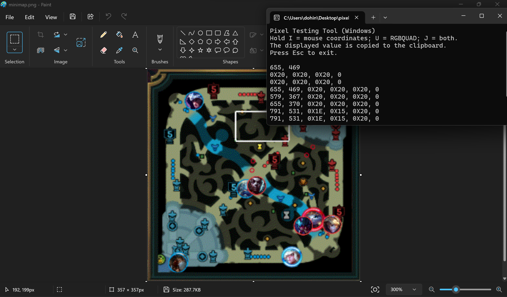

# Demo!!

# Pixel Testing Tool - Visual Studio 2022

A Windows C++ console application I made to quickly get pixel x,y and r,g,b values when I was developing my C++ and Java League of Legends pixel bots!

## Getting started

1. On Windows, make sure **Visual Studio 2022** has **Desktop development with C++** installed.
2. Double-click **PixelTestingTool.sln** (or open it with File > Open > Project/Solution in Visual Studio).
3. Press **Ctrl+F5** to build and run (or **F5** to debug).

## Controls

- Hold **I**: show mouse X, Y coordinates (copied to clipboard).
- Hold **U**: show RGBQUAD at the cursor (copied to clipboard).
- Hold **J**: show both coordinates and RGBQUAD (copied to clipboard).
- Press **Esc**: exit the application.

The app is a console window, not a graphical application. Values are updated while the key is held; if the same value is unchanged, it won't print repeatedly. The app runs only on Windows :(
